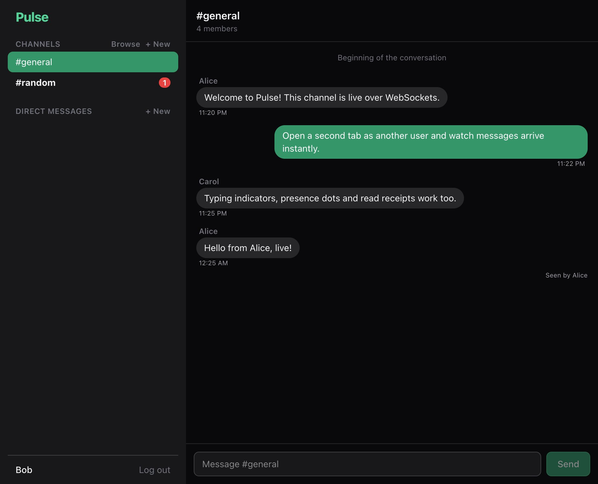

# Pulse - Real-Time Chat

A Slack-style chat app built around **WebSockets**: channels, direct messages, live presence, typing indicators and read receipts. Built with **NestJS + Socket.IO**, **React** and **PostgreSQL**.

| | |
|---|---|
| Live demo | _added after deploy_ |



## Features

- **Live messaging** over Socket.IO with optimistic UI: a message shows instantly and is confirmed by a server acknowledgement
- **Channels and direct messages**, create or browse public channels, search users to start a DM
- **Presence:** online dots update the moment someone connects or disconnects (multi-tab aware)
- **Typing indicators** and **read receipts** ("Seen by ...")
- **Unread badges** per conversation, kept in sync across reconnects
- **Pulse Bot:** DM it and it replies, with a typing indicator, to show server-initiated events
- **Auth:** JWT access + refresh tokens, and the same JWT authenticates the WebSocket handshake
- Persistent history (PostgreSQL) with cursor pagination

## Tech stack

| Layer | Tools |
|---|---|
| Frontend | React 19, Vite, TypeScript, Tailwind CSS 4, Zustand, socket.io-client |
| Backend | NestJS, `@nestjs/websockets` (Socket.IO gateway), Prisma 7, PostgreSQL, class-validator, Swagger, Helmet, rate limiting |
| Tests | Vitest unit tests + a real-time e2e test (two socket clients exchanging messages) |
| CI/CD | GitHub Actions, Render (API), Vercel (web), Neon (database) |

## Architecture

```
React (Zustand store) <-- REST (history, rooms) --> NestJS controllers --+
        ^                                                                 +--> Prisma --> PostgreSQL
        +------ Socket.IO (events below) --------> NestJS ChatGateway ----+
```

- Each socket joins a personal room `user:<id>` and one room per conversation `room:<id>`, so a message is a single `server.to(room).emit(...)`.
- Presence is a `Map<userId, connectionCount>`, a user is offline only when their last tab disconnects.
- Creating a channel or DM uses `socketsJoin` so everyone involved receives the new room live.
- **Scaling note:** presence and rooms live in process memory, which is right for a single instance. For several instances, add the Socket.IO Redis adapter and move presence into Redis.

### Socket events

| Direction | Event | Payload |
|---|---|---|
| client -> server | `message:send` | `{ roomId, content, clientId }` (ack returns the saved message) |
| client -> server | `typing` | `{ roomId, typing }` |
| client -> server | `message:read` | `{ roomId }` |
| server -> client | `message:new` | message with sender and `clientId` |
| server -> client | `typing` | `{ roomId, userId, typing }` |
| server -> client | `room:read` | `{ roomId, userId, at }` |
| server -> client | `room:new` | `{ roomId }` |
| server -> client | `presence` / `presence:list` | `{ userId, online }` / `userId[]` |
| server -> client | `auth:error` | sent before disconnect on an invalid token |

## Run locally

```bash
docker compose up -d                 # Postgres on :5434

cd apps/api
cp .env.example .env
npm install
npx prisma migrate deploy
npm run db:seed                      # demo users and channels
npm run start:dev                    # http://localhost:3001  (docs at /docs)

cd ../web
cp .env.example .env
npm install
npm run dev                          # http://localhost:5173
```

Demo accounts (password `Demo123!`): `alice@pulse.dev`, `bob@pulse.dev`, `carol@pulse.dev`. Open two browsers (or one normal and one private window), log in as two users and watch messages arrive instantly.

## Tests

```bash
cd apps/api
npm test          # unit tests
npm run test:e2e  # boots the app and exchanges messages between two real socket clients
```

## Deploy

`render.yaml` defines the API (set `DATABASE_URL` and `WEB_URL`), the web app is a static Vite build on Vercel with `VITE_API_URL` pointing at the API.

## License

MIT
